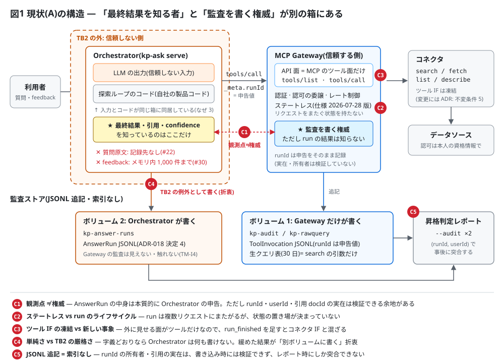
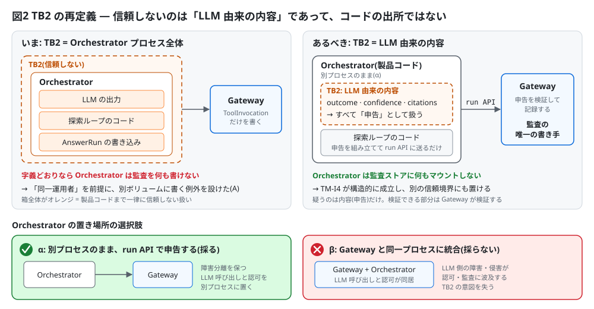
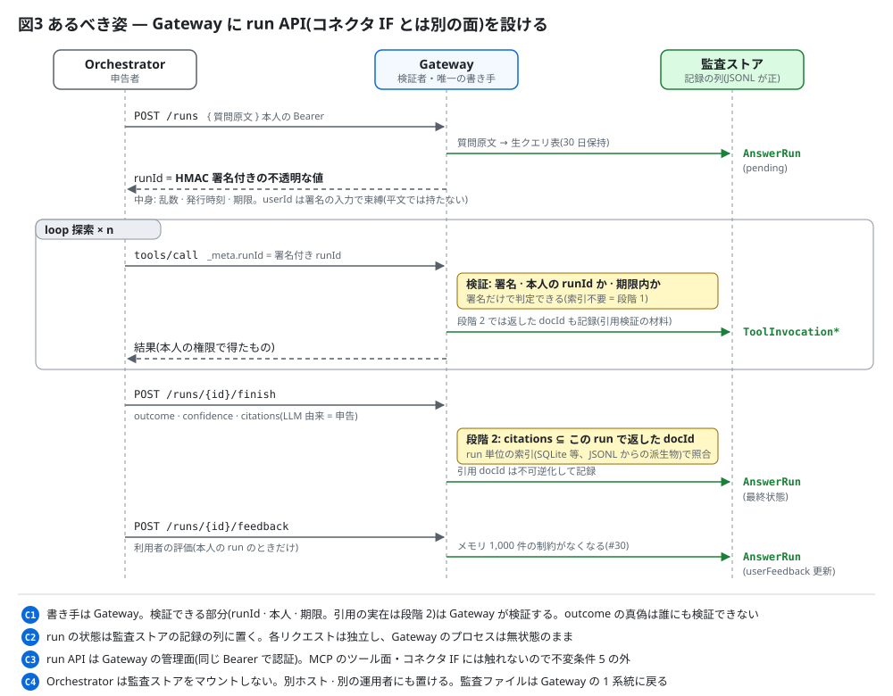
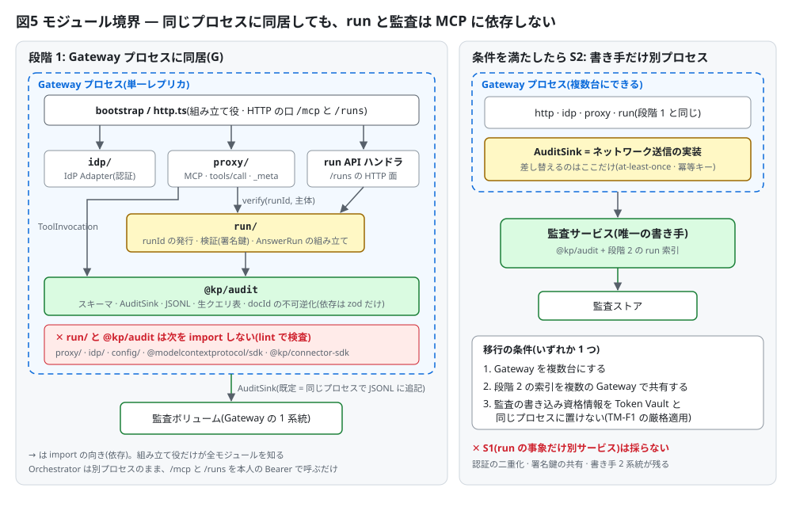
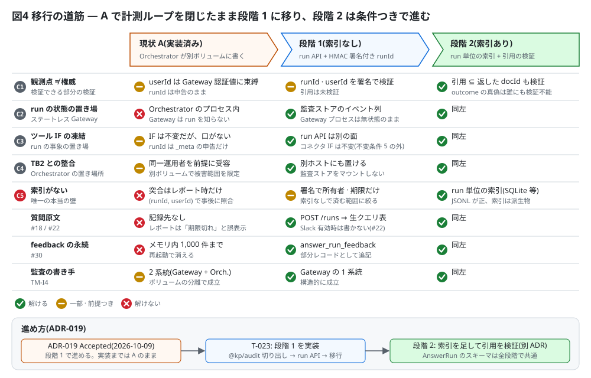

# ADR-019: Gateway の run API と監査の書き手の一本化(段階 1: 署名付き runId)

Status: Accepted(リポジトリオーナー承認 2026-10-09、issue #18。段階 1 で進める)/ Date: 2026-10-09 / 改訂: 2026-10-09(セキュリティレビューの反映。決定3〜6・8・11、帰結、確認事項。安全側の既定を採った点は「人間に確認してほしい点」)

置き換える決定(T-023 の実装をもって効力を持つ。それまでは現状の A が動く):
- ADR-017 決定2 のうち「AnswerRun は Orchestrator が書く」と、確認事項3(AnswerRun の書き手)。終了時の fail-closed は引き継ぐ(決定6)
- ADR-018 決定4(AnswerRun を Orchestrator サービスが別 JSONL に追記する)、決定10 のうち本人確認のための describe、却下した案「Gateway に run 登録 API を作る」
- ADR-011 追記(2026-09-17)と ADR-001 追補3 決定3 のうち、runId の採番主体(iteration は Orchestrator の申告のまま)

ADR-017・ADR-018 は全体としては Proposed のままで、この ADR はそのうち上記の部分だけを確定させる。

## 文脈
監査 2 層(ADR-011)は、Gateway が書く ToolInvocation(ツール呼び出しごと)と、1 質問 = 1 run の AnswerRun(最終結果・confidence・引用・利用者フィードバック)を runId で束ね、昇格判定レポート(T-014)で集計する。これが製品原則 4(監査ログを証拠に Phase 2 を判断する)の計測ループである。

5 観点レビュー(2026-09-27、issue #18)で、このループが出荷構成で完結しないことが指摘された。その後 T-021 で ADR-018 決定4 の案(以下 **A**: Orchestrator が Gateway とは別のボリュームの別 JSONL に AnswerRun を追記する)を実装し、ループは閉じた。ただし A は「Orchestrator は Gateway と同じ運用者・同じ信頼境界で動かす」前提で TB2(Orchestrator は信頼しない)の例外を受け入れたもので、構造上の問題は残っている。

構造的な原因は 4 つある。
1. **観測点と信頼境界がずれている。** ToolInvocation は Gateway が観測できるが、AnswerRun(質問〜最終回答)は探索ループの中でしか観測できない。その探索ループを TB2 の外に置いたため、最終結果を知る者(Orchestrator)と監査を書く権威を持つ者(Gateway)が別になった
2. **Gateway の外向きの面が MCP のツール面だけ。** 外に見せる操作は `tools/list` と `tools/call` だけで、MCP には run の概念がない。runId は `_meta` の申告で運ぶしかなく、仕様 2026-07-28 版(ステートレス)で接続状態から run を推定する道も消えた
3. **TB2 の粒度が粗い。** 信頼できないのは LLM に駆動される入力であって、探索ループのコード(自分たちの製品コード)ではない。現状は両者を同じ箱に入れている
4. **不変条件がツール呼び出ししか想定していない。** 不変条件 2・5 は、run の開始・終了、フィードバック、質問原文といったツール呼び出し以外の監査事象の置き場を定めていない。そのため AnswerRun・質問原文・フィードバックが別々の issue(#18 / #22 / #30)に散った

この結果、次の壁・制約・コンフリクトがある。

| | 内容 |
|---|---|
| C1 | **観測点 ≠ 権威**: AnswerRun の中身は本質的に Orchestrator の申告で、誰が書いても「LLM が何を引用したか」の真偽は検証できない。ただし runId の実在、userId の一致、引用 docId がその run で実際に返した文書か、は検証できる余地がある |
| C2 | **ステートレス Gateway vs run のライフサイクル**: run は複数リクエストにまたがるが、Gateway はリクエストをまたぐ状態を持たない。状態の置き場が決まっていない |
| C3 | **ツール IF の凍結 vs 新しい事象**: MCP のツールに run の事象を足すと、コネクタ IF と Gateway の管理面が混ざる(不変条件 5 の対象) |
| C4 | **単純さ(1 デプロイ = 1 社、同一運用者)vs TB2 の厳格さ**: TB2 を字義どおりにすると Orchestrator は何も書けない。緩めた結果が A の「別ボリュームに書く」折衷 |
| C5 | **JSONL 追記 = 索引なし**: runId の所有者や引用の実在は、書き込み時には検証できず、レポート時にしか突合できない |

A はどれも解いておらず、同一運用者の前提で C4 を受け入れ、別ボリュームで被害範囲を限っているだけである。

## 決定
1. **記録の権威は Gateway に置く。Orchestrator は申告者とする。** 監査ストア(ToolInvocation・AnswerRun・生クエリ表)に書くのは Gateway だけ。Orchestrator は監査ストアのボリュームを一切マウントせず、監査用の鍵(docId の HMAC 鍵、runId の署名鍵)も持たない。観測点(最終結果を知るのは Orchestrator)は動かせないので、Orchestrator が申告し、Gateway が検証できる部分を検証してから記録する

2. **TB2 を「Orchestrator から届くものはすべて申告である」と定義し直す。** Orchestrator のコードは製品コードだが、プロセスは LLM の出力に駆動され、侵害・誤動作しうる。この前提(TB2 の意図)は変えない。変えるのは扱いで、Orchestrator に書き込みの権限を与えて例外を作るのではなく、Gateway が申告を受けて検証する。Orchestrator は Gateway と別のプロセスのまま置く(α)。Gateway と同じプロセスに統合する案(β)は採らない(却下した案)。Orchestrator は利用者のトークンを扱うので、置き場所は従来どおり **Gateway と同じ運用者の下**に限る(別ホストは可。別の運用者に置く構成はトークンの audience 制限・トークン交換(ADR-002)を含む別の ADR とする)

   

3. **Gateway に run API を設ける。** MCP の面(`/mcp`)とは別の HTTP + JSON の面で、MCP のツールでもコネクタ IF でもない(不変条件 5 の外)。run の状態は Gateway のプロセスには持たず、監査ストアの記録の列(下表)として残すので、Gateway はステートレスのまま保てる(C2)

   | 呼び出し | Gateway がすること | 監査ストアに追記するもの |
   |---|---|---|
   | `POST /runs` `{ question, executionClass, actor }` | 本人を認証し、actor を ADR-015 の規則で検証し、署名付き runId(決定4)を発行する | 生クエリ表に質問原文(決定7)→ AnswerRun(`pending`。userId は認証値、actor、startedAt、最終質問 digest) |
   | `tools/call`(`_meta` に runId) | runId を検証してから、従来どおり中継する(決定4) | ToolInvocation(従来どおり) |
   | `POST /runs/{runId}/finish` `{ outcome, confidence, citations, searchedSources, failureReason }` | runId を検証し、searchedSources を有効なソースに限り、引用 docId に決定5 の規則をかける | `answer_run_finish`(部分レコード) |
   | `POST /runs/{runId}/feedback` `{ outcome }` | runId の本人とフィードバックの期間を検証する | `answer_run_feedback`(部分レコード) |

   - **認証は二重にする。** 利用者本人の Bearer(`/mcp` と同じく IdP Adapter で検証)に加えて、**呼び出し元が Orchestrator であることの資格情報**を求める。名前空間付きのキーで runId を申告する `/mcp` の `tools/call` にも同じ資格情報を求める(利用者が UI に出た自分の runId を付けて tools/call を直接呼び、自分の run の再検索回数や searchedSources を歪めることを防ぐ。未申告・旧キーの呼び出しは従来どおり Bearer だけ)。既定はデプロイ固有の共有秘密(Orchestrator と Gateway だけが持ち、runId の署名鍵・docId の鍵とは別)を専用のヘッダで送り、Gateway が定数時間で比較する。mTLS への置き換えは導入先の選択とする。利用者が自分のトークンを別のクライアントで取って run API を直接呼び、AnswerRun を偽って昇格判定の集計を操作することを防ぐため(A では AnswerRun を書けたのは Orchestrator サービスだけだった。ここを後退させない)。トークンの azp / aud の許可リスト(セキュリティレビュー R1)が入ったら、それで置き換えられるかを見直す
   - **記録は追記だけにし、前の状態を読まない。** finish と feedback は AnswerRun 全体ではなく部分レコードとして追記し、昇格判定レポートが runId ごとにフィールド単位で統合する(pending の AnswerRun が土台、finish の最新が結果の欄、feedback の最新が userFeedback)。「最新」は Gateway が記録した時刻で決め、同じ時刻なら冪等キーで決める(sink は at-least-once で再送があり、ファイルの順は当てにしない)。統合するのは部分レコードの userId が pending と一致するときだけにする。土台の pending がない部分レコード(fail-open の構成や保持期間の境目で起こる)は捨てずに「孤立」として数える。finish の再送で userFeedback が消えることはない。A で書いた完全な AnswerRun もそのまま読める。これは ADR-011 の監査スキーマへの追加(部分レコード 2 種)で、スキーマ版の扱いは #30 と合わせる
   - **上限。** リクエスト本文の大きさ・質問の長さ・利用者ごとの頻度の上限を、`/runs` の 3 つの経路すべてにかける(期限内の runId で finish / feedback を再送して監査ストアを埋めることを防ぐ。既定値は T-023 で決め、deployment.yaml で変えられるようにする)

   

4. **runId は Gateway が発行する、HMAC 署名付きの不透明な値とする(段階 1)。** 符号化を次のとおり固定する
   - 形式は `r1.<kid>.<payload>.<sig>`。`kid` は `[a-z0-9]{1,8}`。payload と sig はパディングなしの base64url
   - payload は固定長 28 バイト: 乱数 16 バイト・発行時刻(uint64、秒)・有効期間(uint32、秒)。base64url で 38 文字
   - sig は HMAC-SHA256(32 バイト、43 文字)。入力は `"leisen-runid-v1"`・`ASCII("r1.<kid>.<payload>")`・userId(UTF-8)・actor の正規化表現の 4 つを、それぞれ 4 バイトの長さ(big-endian)を前に付けて連結したもの。版・鍵・用途を入力に含め、値の境界は長さで分ける(区切り文字に頼らないので、userId に制御文字が含まれても曖昧にならない)。actor の正規化表現は、キーを辞書順に並べ空白を含まない JSON(on-behalf-of の連鎖は申告の順のまま)とする。**userId は runId に平文で入れず、署名の入力として束縛するだけにする**(runId は UI の `structuredContent` やログにも出るため。検証時には Gateway が認証した userId があるので再計算できる)。actor も束縛するので、委任エージェント(ADR-015)の呼び出しが人間の run に混ざらない
   - 全体は 94 文字以内で、既存の runId の文字種(`[A-Za-z0-9._:-]`、128 文字以内)に収まり、監査スキーマの runId の欄は変えない
   - **検証**: 形式を確かめ、payload を復号して再符号化した文字列が元と一致すること(base64url の未使用ビットを使った別表記を拒否する)、計算した sig を base64url の文字列にして runId の sig 部分と文字列どうしを定数時間で比べること(sig 側の別表記も拒否する)、期限を確かめる。署名だけで判定でき、索引は要らない(C5 を段階 1 の範囲で避ける)。`tools/call` と `finish` は有効期間内、`feedback` は発行時刻からフィードバックの期間内(既定値は T-023 で決める)で受ける。Orchestrator の run の上限時間(`runTimeoutMs`)は runId の有効期間より短くする
   - **`_meta` の扱い**: 検証の対象は名前空間付きのキー(`io.github.sunaot.leisen/runId`)だけにする。名前空間付きのキーで申告された runId が形式・署名・本人・actor・期限のどれかを満たさなければ、その呼び出しを固定文言で拒否する(申告値はエコーしない。現在の「不正値は未申告扱い」を改める)。拒否した呼び出しも ToolInvocation として残すが、申告された runId は記録せず、新しい単発 run の runId と `errorClass: invalid_run_id` で記録する(他人の run に混ぜない。拒否件数は TM-I5 の検出に使う)。名前空間のない旧キー(`runId`)と未申告の呼び出しは、従来どおり単発 run として記録する(Gateway に直接つなぐ汎用の MCP クライアント向け)。iteration は従来どおり Orchestrator の申告とする
   - **署名鍵**: 32 バイト以上のランダム値をデプロイ固有の秘密として環境変数から渡し、docId の HMAC 鍵・Orchestrator の資格情報とは分ける。鍵がない・短い・開発用の既定値(`.env.example` の値など)のときは production での起動を拒否し、別の鍵で代用しない。`kid` で現行と 1 つ前の鍵を同時に受ける。漏えい時は両方を入れ替え、期限内の run が無効になることを受け入れる。鍵はログ・監査・エラー・設定の出力(`kp-gateway validate` 等)に出さない(不変条件6)。鍵が漏れた場合の影響は、本人のトークンを持つ範囲で未発行の runId や長い期限の runId を作れることまでで、他人にはなりすませない(署名の入力に userId が入り、Bearer の検証は別にある)
   - 段階 1 で検証できるのは「runId を Gateway が発行したこと・本人と actor の run であること・期限内であること」まで。**引用がその run で返した文書かは Gateway では検証しない**(段階 2)。Orchestrator 側の出典の検証(ADR-017 決定3)は申告の質を保つ手段としてそのまま残す。outcome の妥当性はどの段階でも誰にも検証できない(C1 の残り)

5. **引用 docId の記録は、申告された sourceId に頼らない。** 段階 1 の Gateway は引用の出所を検証できないので、docId の不可逆化(ADR-013 §2、不変条件7)の分類に申告の sourceId を使わず、最も厳しい規則を全件にかける
   - deployment.yaml で永続化不可のソース(Slack)が有効な構成では、段階 1 の間は citedDocIds を空にし、searchedSources だけを残す
   - それ以外の構成で、プライベートスコープを持つソースが有効なら、全件に `audit.privateScopeDocIds` の規則(既定 hashed。HMAC は決定的なので参照頻度の集計は保てる)をかける
   - 有効でない sourceId の引用は記録しない。searchedSources は有効なソースだけを残す(現在の Orchestrator 側の規則を引き継ぐ)
   - 段階 2 で引用を返却 docId と照合できるようになったら、照合済みの出所で分類する

6. **書き込みに失敗したときの挙動は ADR-011 §4 に従い、Orchestrator の終了時の fail-closed を引き継ぐ。** 既定(fail-closed)では、`POST /runs` は生クエリ表と pending のどちらかを書けなければ runId を返さず(書く順は生クエリ表 → pending。生クエリ表だけ残った行は保持期間で消える)、Orchestrator は LLM を呼ばない。`finish` を書けなければ Gateway は失敗を返し、**Orchestrator は回答を返さない**(ADR-017 決定2 の終了時の fail-closed)。`feedback` を書けなければ利用者にエラーを返す。deployment.yaml で明示的に fail-open にした構成では、run API も同じ設定に従う(可用性を優先する判断は導入先のセキュリティポリシーで明文化済みのため。プレイブックに run API も対象であることを書く)

7. **質問原文は `POST /runs` で生クエリ表に書く**(issue #18「質問原文の記録先」の A)。保持期間は ADR-011 §3・ADR-013 に従う(既定 30 日)。結合キーは AnswerRun の最終質問 digest と生クエリ表の digest。ただし永続化不可のソース(Slack)が有効な構成では、#22 が決まるまで質問原文を書かず digest だけを残す(不変条件7 を安全側に倒す)

8. **フィードバックは `answer_run_feedback` として永続化する**(#30 のうち永続性)。Orchestrator のプロセス内に最終状態を覚えておく必要(既定 1,000 件)はなくなり、ADR-018 決定10 の「本人確認のための describe(`feedback:<UUID>` の別 runId)」も要らなくなる。本人であることは runId の署名で確かめる

9. **書き手は Gateway のプロセスに同居させる(G)。** 永続化は既存の `AuditSink`(監査レコード)と `RawQueryStore`(生クエリ表。監査レコードとはアクセス経路を分けてある)の向こう側に置く。次のいずれかを満たしたら、この 2 つをネットワーク越しに送る実装に差し替え、書き手だけを別プロセスの監査サービスに移す(S2)。run API とその受付・認証・検証は Gateway に残る
   - Gateway を複数台にする(単一レプリカの前提を外す。docs/install.md の「将来のスケールアウトの条件」)
   - 段階 2 の索引を複数の Gateway で共有する必要が出た
   - 導入先の要件で、監査の書き込み資格情報を Token Vault と同じプロセスに置けない(TM-F1 の厳格適用)

   run の事象だけを別サービスで受ける案(S1)は採らない(却下した案)

10. **モジュールの境界を固定する。** 同じプロセスに同居しても、run と監査のモジュールは MCP に依存させない
    - 監査のモジュール(現 `packages/gateway/src/audit/`)を `packages/audit`(`@kp/audit`)として切り出す。依存は zod と Node の標準ライブラリだけにする。orchestrator と promotion-report は `@kp/gateway` ではなく `@kp/audit` から読む
    - run の発行・検証・監査レコードの組み立ては run モジュールに置く。runId の概念(現 `proxy/session.ts` の `isValidRunId`)も run モジュールが持つ。run モジュールは認証済みの主体(userId・actor)と値だけを受け取る
    - run モジュールと `@kp/audit` は、`proxy/`・`idp/`・`config/`・`@modelcontextprotocol/sdk`・`@kp/connector-sdk` を import しない。lint の import 制限で機械的に検査する。組み立て役(bootstrap / http.ts)だけがすべてを知る
    - ソースの知識(有効なソース、Slack・プライベートスコープの有無)は run モジュールに入れず、組み立て役が判定の関数として注入する
    - リクエストを失敗させるかどうか(決定6)の判断は呼び出し側が行う。run モジュールと sink は例外を投げるだけにする(現在の sink と同じ分担)

    

11. **段階 2(引用の検証)はこの ADR の範囲外とし、別の ADR で決める。** run 単位の索引(SQLite 等。JSONL を正とし、索引は派生物)と、ToolInvocation に返した docId(不可逆化済み)を持たせるスキーマ変更(ADR-011 の改訂)が要る。申し送り: 索引に入れるのは認可の後に返した docId だけにする(不変条件3)。索引のキーは (runId, userId) にする(不変条件4)。引用の照合に失敗してもソースに照会し直さない。決定9 の移行の条件と合わせて判断する

12. **移行。** T-023 が入るまでは A(ADR-018 決定4 の実装)のまま運用する。入った後は Orchestrator は AnswerRun を書かず、`--answer-run-jsonl`、リファレンス構成の `kp-answer-runs` ボリューム、Orchestrator への `KP_AUDIT_HMAC_KEY` の受け渡しを廃止する。A で書いた過去の JSONL は昇格判定レポートで引き続き読める(`--audit` の複数指定は残す)

## 理由
- **C1(観測点 ≠ 権威)**: 観測点は動かせないので、権威の側を一本にする。書き手が Gateway になると、検証できる部分(runId の発行元・本人・actor・期限)は Gateway が検証してから記録する。outcome の真偽が検証できないのは誰が書いても同じで、この ADR で悪くなる点はない
- **C2(状態の置き場)**: run の状態は監査ストアの記録の列に置き、各リクエストは独立したままにする。runId の検証は署名で完結し、finish と feedback は前の状態を読まない部分レコードなので、Gateway はリクエストをまたぐ状態を持たない(ADR-001 追補3 と両立する)
- **C3(ツール IF)**: run API は MCP のツール面に足さない。ツールに足すと LLM から見える `tools/list` に管理操作が並び、コネクタ IF(search / fetch / list / describe)と混ざる
- **C4(TB2)**: Orchestrator は監査ストアに一切の書き込み権限を持たないので、TM-I4(Orchestrator から監査を読む・改竄する)は構成の工夫ではなく構造で成り立つ。Orchestrator を Gateway と別のホストに置いても、監査ボリュームの共有は要らない
- **C5(索引なし)**: 段階 1 は、索引がないと検証できないもの(引用の実在)を後回しにし、署名で検証できるもの(発行元・本人・期限)に絞る。これだけで C2・C3・C4・質問原文・フィードバックが片づき、C1 は半分片づく
- **G を選び S2 を今は選ばない理由**: run API の受付は、本人の束縛(= 認証)が要るので、IdP Adapter を持つ Gateway から動かせない。G と S2 の違いは永続化の書き手の置き場所だけである。いまは単一レプリカで、1 社 1 デプロイの小規模な導入も多い。S2 にするとコンテナ・秘密情報・監視が増え、すべての tools/call が fail-closed で監査サービスの可用性に依存する。`AuditSink` は at-least-once と冪等キーで設計済みなので、条件を満たしたときに sink を差し替えるだけで移れる
- **Orchestrator の資格情報を求める理由**: 本人の Bearer だけでは、利用者が Orchestrator を通さずに自分の run の結果を偽れる。A では AnswerRun を書けたのは Orchestrator サービスだけだったので、ここで後退させない
- **userId を runId に平文で入れない理由**: runId は監査のほか UI の `structuredContent`・ログにも出る。検証時には Gateway が認証した userId が手元にあるので、署名の入力に含めれば束縛には十分である
- **A のまま終えない理由**: A は C1〜C5 のどれも解かない。質問原文(#22)・フィードバックの永続(#30)の置き場も決まらず、issue が散ったままになる

## 帰結
- **Gateway**: `/runs` の 3 つの経路、run モジュール、runId の署名鍵と Orchestrator の資格情報の設定(deployment.yaml のスキーマ、T-010 の profile)を足す。リバースプロキシの設定例(docs/install.md §6 の `location = /mcp`)に `/runs` を足し、同じ期限・本文上限をかける。`_meta` の不正な runId の扱いが「未申告扱い」から「拒否」に変わる(名前空間付きのキーだけ)
- **Orchestrator**: run の開始時に `POST /runs` で runId を受け取る(失敗したら LLM を呼ばない)。終了時に `finish` を呼び、失敗したら回答を返さない。`kp-ask serve` の `feedback` ツールは `POST /runs/{runId}/feedback` を呼ぶ。AnswerRun の書き込み・`docIdAudit` の鍵・プロセス内の run の記憶・本人確認の describe をやめる。AnswerRun.userId の束縛(セキュリティレビュー H1)は、Orchestrator 側の照合ではなく、Gateway が認証値で書くことで構造的に成り立つ。T-023 の実装後、tools/call の結果の `_meta` に userId を載せる必要が残るかを見直す(利用者の識別子を出す範囲を縮めるため)
- **監査スキーマ**: 部分レコード `answer_run_finish` と `answer_run_feedback` を足す。昇格判定レポートは runId ごとにフィールド単位で統合し、有効期間を過ぎても pending のままの run を「放棄」として数える(finish を送らずに unresolved を隠すことを見えるようにする)
- **監査ストアの系統**: Gateway の 1 系統に戻る。昇格判定レポートの入力も 1 つで足りる(過去の A の JSONL を読むために複数指定は残す)
- **運用**: fail-closed なので、監査ボリュームの容量が尽きると全利用者の tools/call と run が止まる。容量の警報を docs/install.md の運用項目に足す
- **脅威モデル**: TB2 の記述を決定2 に合わせて改める。TM-C6・TM-I1・TM-I4 に実装後の扱いを足す。run API の脅威を TM-I5 として足す
- **不変条件**: 2(全ツール呼び出しを Gateway で監査)は変わらず、run の事象も Gateway を通るようになる。文言に run の事象を含めるかは確認事項3。5(コネクタ IF)には触れない。6 は署名鍵と Orchestrator の資格情報に適用する。7 は決定5・決定7 と既存の docId 不可逆化で守る
- **残る限界**:
  - 侵害された Orchestrator は、手元の利用者トークンと Orchestrator の資格情報で、その利用者の期限内の run の結果を偽って申告できる(A と同じ。範囲はその利用者に限られる)
  - Orchestrator の資格情報が漏れると、利用者が自分の run の結果・ToolInvocation を偽れるようになる(集計の汚染。他人の run には触れない)
  - 引用の実在は段階 2 まで Gateway では検証しない。Slack が有効な構成では段階 1 の間 citedDocIds を記録しない(引用の集計が減る)
  - 期限内の runId は、同じ本人・actor なら再利用できる(finish・feedback の再送は最新が勝つ。上限で量は抑える)
- **issue への影響**: #18 の書き手と質問原文の記録先はこの ADR で決まる。#30 の永続性は決定8 で決まる(同一性・スキーマ版は #30 で別に扱う)。#22 は Slack 有効時の扱いだけが残る

## 却下した案
- **A のまま(ADR-018 決定4)**: 計測ループは閉じるが、構造上の問題(C1〜C5)を解かない
- **A′: Orchestrator が Gateway と同じ監査ストアに書く(ADR-017 決定2 の原文)**: Orchestrator が Gateway の監査ファイルを書き込み可能で持つことになる(TM-I4)
- **β: Orchestrator を Gateway と同じプロセスに統合する**: LLM の呼び出しと認可・Token Vault が同居し、LLM 側の障害・侵害が認可と監査に波及する。TB2 の意図を失う
- **S1: run の事象だけを別の監査サービスで受ける**: 監査サービスにも IdP Adapter が要って認証が二重になる。runId の署名鍵を Gateway と共有することになり、書き手も 2 系統のまま残る
- **S2 を今すぐ採る**: 決定9 の条件をまだ満たしておらず、運用コストと可用性の依存が増えるだけになる。sink の差し替えで後から移れる
- **run の操作を Gateway の MCP ツールとして足す(`run_start` 等)**: LLM から見えるツール面に管理操作が混ざり、コネクタ IF の変更(不変条件5)に当たる
- **Gateway のプロセス内に run の状態を持つ**: ステートレスの前提(ADR-001 追補3)に反し、再起動や複数台で壊れる
- **finish・feedback で AnswerRun 全体を置き換える**: Gateway は前の状態を持たないので完全なレコードを組み立てられず、finish の再送で userFeedback が消える
- **run API を利用者の Bearer だけで受ける**: 利用者が Orchestrator を通さずに AnswerRun を偽れる(A からの後退)
- **runId に userId を平文で入れる**: UI・ログに利用者の識別子を広げる。束縛には署名の入力に含めれば足りる
- **段階 2 を同時に行う**: 索引と ToolInvocation のスキーマ変更が要り、移行の条件(決定9)と合わせて決めるべきである

## 人間に確認してほしい点
セキュリティレビュー(2026-10-09)で判断が要るとされた点は、いずれも安全側の既定を採って本文に入れた。変える場合はこの ADR を改訂する。
1. **run API の呼び出し元の認証(決定3)**: 利用者の Bearer に加えて Orchestrator の資格情報(既定は共有秘密)を求める。残余として受け入れて Bearer だけにする案もある
2. **Slack が有効な構成での引用の記録(決定5)**: 段階 1 の間は citedDocIds を記録しない。コネクタごとの docId の文法で出所を検証して記録する案もある(コネクタに文法の宣言が要る)
3. **不変条件2 の文言**: 「全ツール呼び出しを監査ログに記録する」に「run の事象(開始・終了・フィードバック)も Gateway が記録する」を加えるか。CLAUDE.md の不変条件の改訂は人間の判断とし、この ADR では変えていない
4. **fail-open の適用範囲(決定6)**: 明示的に fail-open にした構成では run API も同じ設定に従う。run API だけは常に fail-closed にする案もある

## 図
図の元ファイル(SVG)は `docs/adr/figures/ADR-019/` にある。
- 図1 `fig1-current-structure.svg`: 現状(A)の構造と C1〜C5 の位置
- 図2 `fig2-trust-boundary.svg`: TB2 の再定義と α・β
- 図3 `fig3-run-api-sequence.svg`: run API のシーケンスと記録の列
- 図4 `fig4-migration-path.svg`: 現状 A・段階 1・段階 2 で解ける問題と進め方
- 図5 `fig5-module-boundary.svg`: モジュール境界と書き手の置き場所(G と S2)
